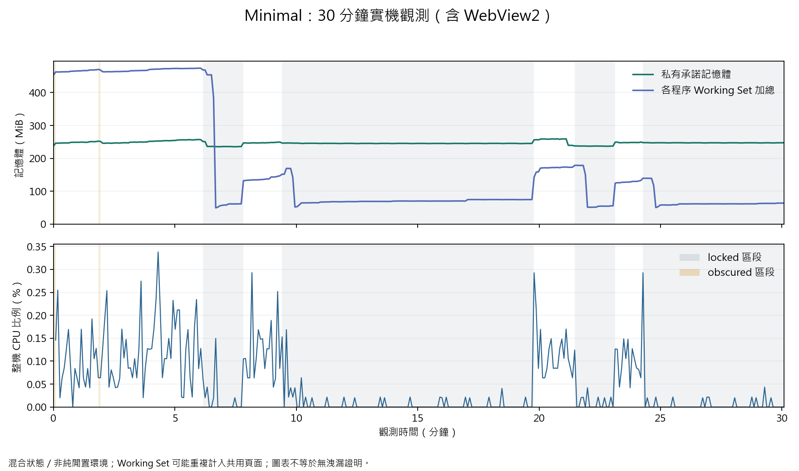

# Minimal 30 分鐘混合狀態觀測

2026-10-28 17:50 啟動，暖機 60 秒後採樣，18:21 完成（時間依受測電腦）。Windows 11 Pro 25H2 26200.8737、Intel Graphics、14 個作用中邏輯處理器。受測為非 mock Minimal Preview，EXE SHA-256 `0015E2FD2F58CA792A7C98F4E8020CC6E5C64E8A5CAB23B0383784BCF7D77EB9`，即 Runtime 階段版本；不冒充後續 renderer 復原版本的效能證據。

**完成：30 分鐘資料收集、狀態分組分析與正常清理；A13 完整效能矩陣仍為 PARTIAL。**

## 證據品質

- 343 筆，CSV 首末實際跨度 **1804.606 秒**；RunStatus=COMPLETED，指定 1800 秒已覆蓋。
- 全部都有根 app 及 WebView2，固定 7 個程序、同一組 PID；0 筆不完整子樹、0 次讀值略過。
- 342 個有效 CPU 差分區間，沒有因 PID 集合、負差值或超大時間缺口而排除。CPU 以 14 個作用中邏輯處理器的整機容量計算。
- 118 筆 active、223 筆 locked、2 筆 obscured。依原生狀態標題分組；狀態切換區間不混入單一狀態的 CPU 平均。不是整段 Active 或純閒置的控制實驗，其他開發工作可能同時存在。
- 原始 [samples.csv](samples.csv)、[metadata](samples.metadata.json)、[runner 紀錄](run.json)、[完整分析](analysis.json)。資料與分析沒有改寫實際跨度或把缺值當作 0。

## 結果

| 項目 | active | locked |
| --- | ---: | ---: |
| 可歸類的穩定 CPU 區間合計 | 596.194 秒 | 1154.701 秒 |
| CPU 平均（整機容量） | 0.1159% | 0.00628% |
| CPU p95（約 5 秒區間平均） | 0.2519% | 0.02179% |
| Private Bytes 平均 | 250.61 MiB | 244.62 MiB |
| 各程序 Working Set 加總平均 | 332.10 MiB | 82.98 MiB |

此筆觀測中 locked 的平均 CPU 較 active 低約 **94.6%**，符合節能方向；未控制其他負載，也沒有測量整機功耗，因此不宣稱普遍節能比例。obscured 僅 2 筆，沒有連續同狀態區間，CPU 統計為 null，不給假 0 或 NaN。

整段 Private Bytes 起訖 **237.95→247.33 MiB**，範圍 **235.36–259.37 MiB**。Working Set 起訖 **453.50→63.79 MiB**，可能重複計入共用頁面，不能當作唯一實體記憶體使用量。總 handles **3335→3297**，根 app handles **363→361**。

Private Bytes 整體線性趨勢 -0.046 MiB/min；跨多個 locked 區段的斜率 +0.191 MiB/min，起訖增加 9.39 MiB。圖中可見隨狀態改變而回落及平臺，但不能把整體負斜率當成沒有洩漏的證明；仍需更長及同狀態對照。



## 清理與權限

由 agent 正常關閉，退出碼 0；關閉前辨認的 6 個存活子程序皆退出，沒有無法確認或仍存活的子程序。觀測執行緒的暫時電源需求已還原，沒有改寫電源計畫。開始時 session=unlocked；中途 locked 依實際 Windows 工作階段事件改變，runner 沒有發送模擬鎖定訊息或自動登入。

## 重現分析

```powershell
.\docs\acceptance\2026-10-28\long-observation\analyze-observation.ps1 -Directory docs/acceptance/2026-10-28/long-observation
uv run --managed-python --no-project --python 3.12 --with matplotlib==3.10.7 python docs/acceptance/2026-10-28/long-observation/plot_observation.py docs/acceptance/2026-10-28/long-observation
```

圖表已直接檢視，中文字型與圖例無裁切。這是離線開發分析工具，不增加產品 Python runtime。此機 Windows Store Python 的 Scripts 路徑缺失，改用 uv managed Python 3.12.11 完成繪圖。

## 尚未完成的效能條件

- active 穩定區間合計 596.194 秒，未湊整成至少 600 秒的 Active 證據。
- 缺同版本 Dashboard 對照、GPU Engine 計數、真實 display-off／全螢幕矩陣、切換後長期趨勢及其他 Windows 組態。
- 這是 Preview，不能當成真正桌布模式的效能驗收；整體發行閘門保持阻擋。
