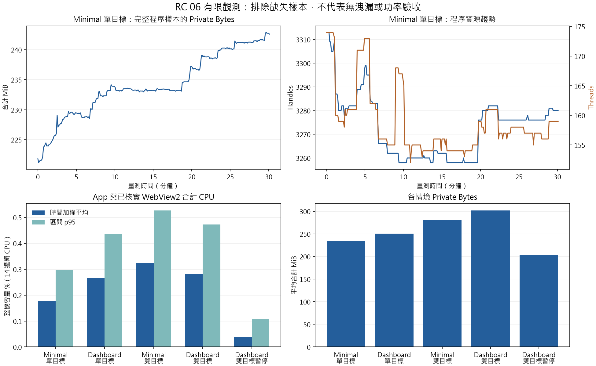

# RC 06 硬體讀值與效能省電

本票可執行驗證與報告完成，Status resolved；A05／A13 仍有 PARTIAL／NOT RUN，不代表 RC 通過。分支 `feature/rc-06-metrics-performance`，來源 HEAD `c244682204bc3a85b50cd46e15bc50e066eea3b7`。05 resolved；只補本票 A05／A13，完整套件留 09，不合併 main、不解除 RC gate。本票僅一次 commit＋push，實際提交見該分支 Git 記錄。

## 版本、環境及隔離

產品程式未修改。EXE 是 RC 05 固定版隔離副本，SHA-256 `25316B5067076749295B62DB557748B6DC2D88C4069CFBBE4C48E93269F6D26D`，與來源 HEAD 交付的驗證 EXE 相同；不是新試用／RC ZIP。新工具、CMake 手動探針 target、相關測試與報告屬於本票工作樹。首輪工具與後續修正分開記錄，不把工具失敗當產品 Red。

Windows 11 Pro 25H2 26200.8737／WebView2 156.0.4314.50／SDK 1.0.2478.35；Core Ultra 7 155U，14 邏輯處理器、32 GiB 級實體 RAM、Intel Graphics 32.0.101.8860、SN740 NVMe。兩個1920×1080顯示器、DPI144／96，原生重新列舉見 [monitors.log](monitors.log)。平衡電源配置，開始記錄為接電／電池100%。登錄檔 ProductName 沿用 Windows 10 字串，以 CIM Caption／實際 build 判定 Windows 11。

路徑為 `%USERPROFILE%/DrillPaperTests/硬體效能 含空白/rc06`，每組獨立 LOCALAPPDATA 與 WebView2 profile；由既有 `security-launcher.mjs` 的 Node `spawn` 直接啟動 EXE，PowerShell 僅控制工具。不解壓或啟動未簽章 EXE 於 Temp、不修改防毒。保留原持續桌布 path／精確建立時間／hash，不停止或替換；不重啟 Explorer，不呼叫電源保持／喚醒 API。一般開發及背景程序仍在執行，非乾淨獨占機器。

## 執行前定義的方法與門檻

原定義先寫入 [ticket](../../../../.scratch/rc-delivery/issues/06-metrics-performance.md)，再啟動量測。各組循序執行，暖機60秒，資源約每5秒讀取一次（CIM／PDH 成本使實際間隔較長，依原始單調時間計算），不以要求秒數代替首末樣本的實際跨度。

| 情境 | 暖機後最少原始跨度 |
| --- | ---: |
| Minimal 單目標 Active | 1800秒 |
| Dashboard 單目標 Active | 600秒 |
| Minimal 雙目標 Active | 600秒 |
| Dashboard 雙目標 Active | 600秒 |
| Dashboard 雙目標手動暫停 | 600秒 |

Active 固定 `smartSleep=false`，避免前景全螢幕覆蓋改變量測政策；暫停由正式管理命令切換，非真正 Locked／DisplayOff。兩種主題每目標均為完整內容，核對各宿主 caption／load／ready／visible，保存時的 `settings.theme` 不代表後續直接切換的有效主題。

此處 Active 指有效runtime政策，不宣稱連續獨立觀察到實體面板開啟／沒有鎖定。未設防睡或喚醒，真正OS狀態另依人工清單補驗。100ms屬性輪詢及CIM／PDH本身有觀測成本，app程序合計不包含觀察器，不代表全機功率／總CPU節省。

CPU 以相同程序身分的累積 CPU 秒差／實際間隔／14×100，時間加權平均及區間 nearest-rank p95；app 與所有當下可追溯且核實的 WebView2 分開保留 raw，摘要採合計。Private Bytes／WS／handles／threads 逐程序保留；WS 合計可能重複共享頁面，不能當實體獨占用量。父子建立時間須合理，程序 handle 固定實體，跳過未核實讀取並記原因；不完整樣本排除資源統計，相鄰 CPU 區間無效。只對已觀察並核實的子程序等待退出，不宣稱抓到所有取樣間短命程序。

GPU Engine 以跨語系 PDH wildcard query 取得各 PID／LUID／engine 實例，僅歸屬已核實 PID。缺失保留錯誤而非零；engine sum 是多引擎活動量加總，可能超過100%，不是單一裝置使用率或功率。查詢初始化的第一筆區間與資源暖機／CPU窗口不完全相同，原始counter另列，不作精準功耗推論。

預定 Active 合計 CPU 平均<=1%、p95<=3%；1800秒 Minimal 的末300秒對首300秒 Private Bytes 中位數差<=32MiB、OLS<=1MiB/min、handles／threads 中位數增量各<=10。超標先調查；有限穩定觀測不能排除洩漏。前後版本、單／雙目標或主題差異是本機對照，不宣稱因果效應或普遍資源保證。

每100ms唯讀觀察 MetricsTick／HealthTick 的**變化次數**，每次資源樣本保存累計數：Active 推送觀察0.7～1.2Hz、JS回應0.12～0.25Hz，epoch保持；暖機後手動暫停兩者不前進、所有宿主隱藏且顯示已暫停，CPU平均低於 Dashboard 雙目標 Active。這些屬性是最後推送／JS回應時間戳，不是collector呼叫數，也不是像素畫面。Worker設定Active1000ms（每次collect完成後等待）、手動暫停0；實際每次API讀取頻率直接觀測 **NOT RUN**，不由renderer推論。

硬體工具使用公開 WindowsMetricsCollector，基線／單執行緒CPU負載／64MiB記憶體與本機檔案寫入各30個約1秒窗口。CPU對獨立PDH `Processor(_Total) % Processor Time` query，平均絕對差<=5百分點；RAM對GetPerformanceInfo實體pages×pageSize，total差<=1page、used平均絕對差<=64MiB；disk對獨立 `PhysicalDisk(_Total) % Disk Time` query，平均絕對差<=5百分點；network對GetIfEntry2各啟用硬體介面octets的單調差值，平均絕對差<=max(64KiB/s,參考平均10%)。每個速率窗口**兩端** collector／reference skew皆<=100ms才比較；缺足夠窗口記PARTIAL，不放寬容差。

CPU／磁碟負載在效能矩陣後執行；磁碟負載是64MiB檔案與每區間2MiB邏輯更新／flush，非強制硬體寫穿或磁碟吞吐量校準。網路只取自然實體介面流量，沒有授權可控peer，不製造第三方流量。獨立query／API仍讀同一OS來源，這是系統契約交叉核對，不是獨立儀器校準；disk counter 不等於工作管理員 Active Time。NVIDIA缺設備時unavailable不算NVML實讀通過。

參考：[PDH rate需要兩筆樣本](https://learn.microsoft.com/en-us/windows/win32/perfctrs/collecting-performance-data)、[GetPerformanceInfo pages](https://learn.microsoft.com/en-us/windows/win32/api/psapi/ns-psapi-performance_information)、[GetIfEntry2](https://learn.microsoft.com/en-us/windows/win32/api/netioapi/nf-netioapi-getifentry2)、[GPU wildcard格式化陣列](https://learn.microsoft.com/en-us/windows/win32/api/pdh/nf-pdh-pdhgetformattedcounterarrayw)。

每個硬體phase先預備採集並等待1秒完成provider／介面冷啟動，再記錄正式基準與skew；正式仍取30個窗口，沒有在結果出爐後放寬容差，原始窗口全部保留。

## 工具驗證與已保存的失敗

相關 CTest [ctest.log](ctest.log) 18/18 PASS，原生螢幕列舉 [monitors.log](monitors.log) 1/1 PASS；不代表完整回歸或硬體精度已通過。工具 [build.log](build.log)、[暖機端點重建](build-baseline.log) PASS；初次新探針編譯漏 ws2def／ws2ipdef／pdhmsg include，修正後通過，屬編譯錯誤，沒有當作產品 Red。

分析工具循序 Red→Green：CPU容量、PID重用、不足時長、記憶體斜率、推送／JS觀察頻率、缺GPU、缺失樣本、錯開窗口。審查另重現拒絕既有目錄後 finally 覆寫結果，補createdSession旗標；初次入口測試另發現Console輸出CP950，已固定UTF-8。原始 Red／Green 日誌均保留；分析器本機10/10 PASS，最終相關檢查另補。

第一輪 Minimal 長測 `minimal-single` 在7筆／38.626秒資料後，CIM列舉的短命程序在取得handle前已消失，工具停止；app正式退出0、6個已觀察子程序退出。這輪 **未完成**，不是1800秒結果或產品效能FAIL。後續工具補記skipped、合理父子建立時間與不完整樣本，長測重跑為 `minimal-single2`；不刪除舊結果，不靠重跑隱藏工具缺陷。

`minimal-single2` 使用較早載入的採樣器，後續新增的createdSession／UTF-8錯誤輸出、GPU以成功讀值PID再核實、有效主題caption斷言不會回溯修改已載入程式。其raw保存的path／start／complete／skipped／GPU實例／caption／epoch可由最終分析器重算及逐筆核對；工具版本差異明列，沒有宣稱所有情境使用完全相同工具位元。

## 實測結果

五組皆達事先定義的實際跨度，總計664筆；3筆資源讀取不完整與相鄰6個CPU區間排除。所有宿主逐筆主題／目標數／epoch／可見性均符合、未知GPU PID實例0，五次正式退出碼皆0，33個已觀察並核實的WebView2子程序均退出。這不是所有取樣間短命程序的清理證明。來源與衍生總表見 [matrix-summary.json](matrix-summary.json)。

| 情境 | 秒／筆 | CPU平均／p95 % | Private／WS平均 MiB | Handles範圍／Threads範圍 | GPU engine sum平均 % | 缺失資源／無效CPU區間 |
| --- | ---: | ---: | ---: | --- | ---: | ---: |
| [Minimal 單目標](minimal-single2/summary.json) | 1805.80／282 | 0.1780／0.2976 | 234.12／456.60 | 3258–3313／152–174 | 0.1765 | 1／2 |
| [Dashboard 單目標](DashboardSingle/summary.json) | 603.49／95 | 0.2661／0.4365 | 250.62／471.12 | 3334–3375／159–179 | 0.3002 | 1／2 |
| [Minimal 雙目標](MinimalMulti/summary.json) | 602.01／92 | 0.3241／0.5271 | 280.43／546.24 | 3742–3805／183–204 | 0.3404 | 1／2 |
| [Dashboard 雙目標](DashboardMulti/summary.json) | 603.59／97 | 0.2820／0.4722 | 301.96／567.47 | 3763–3813／183–204 | 0.4499 | 0／0 |
| [Dashboard 雙目標暫停](DashboardPaused/summary.json) | 603.81／98 | 0.0372／0.1084 | 203.68／86.93 | 3613–3666／154–173 | 0（98筆有效） | 0／0 |

Active各組CPU均達預定平均<=1%、p95<=3%；推送觀察0.8621～0.9361Hz、JS回應0.1906～0.1988Hz，均在預定範圍。雙目標比單目標多一個renderer（合計8對7程序）；同為約600秒的Dashboard平均Private Bytes增加51.34MiB，CPU增加0.01589百分點。各組是循序、非獨占主機觀測，Minimal單目標平均窗口1800秒、其餘600秒；不能藉這張表宣稱主題CPU優劣、獨立探針增量或普遍成本。量測前段同時有工具編譯／測試／繪圖依賴下載，背景活動未固定。

手動暫停相對Dashboard雙目標Active，CPU平均下降約86.82%；兩宿主全程隱藏／標題已暫停、MetricsTick與HealthTick變化皆0、epoch不變，98筆可歸屬GPU engine全為有效0。這是本機手動暫停觀測，不是瓦數或真正Locked／DisplayOff結果。各組10分鐘的斜率只列原始摘要，不套用僅對1800秒Minimal單目標定義的長測門檻。



圖表以完整資源樣本重算，已目視確認文字／刻度／圖例完整；這是靜態圖表QA，不是app畫面驗收。來源腳本為 `scripts/plot-metrics-performance.py`，Python3.13.1／matplotlib3.11.2，命令見 [plot.log](plot.log)。

Minimal 單目標已完成：[原始282筆](minimal-single2/samples.jsonl)、[結果／退出](minimal-single2/result.json)、[可重算摘要](minimal-single2/summary.json)、[資源CSV](minimal-single2/resources.csv)。實際跨度1805.8009秒，資源間隔平均6.4263／最大7.0161秒；一筆短命程序在列舉後消失，排除該筆資源及相鄰2個CPU區間，不能聲稱零漏讀。其餘完整資料觀測 CPU平均0.17795%、p95 0.29758%；Private Bytes平均234.12MiB、OLS +0.56866MiB/min、首末五分鐘中位數+14.16797MiB；handles／threads中位數增量-9／-4。這些觀測值達預定資源門檻，資料完整性為PARTIAL，仍有記憶體上升，不能排除洩漏或推論長期無界成長不存在。

推送觀察0.90652Hz、JS回應0.19437Hz；逐筆有效主題／目標數／load／ready／visible均符合，GPU未知PID實例0，282筆皆有可歸屬GPU engine。7個已核實主要程序維持可追溯，engine sum平均0.17652%，不是裝置功率。正式退出0、6個當下與歷史已觀察子程序均已退出；短命未取得handle者不算清理通過證據。原始第一輪未完成資料見 [minimal-single](minimal-single/result.json)，不覆蓋。

### 同期硬體精度

[原始93筆（含3個基準）](accuracy/readings.jsonl)、[分析](accuracy/readings.jsonl.summary.json)、[時間與hash](accuracy/metadata.json)：三phase各30窗口，沒有skew排除，樣本時間序列跨度93.06秒。含基準的最大skew23.9869ms、正式collector最大執行15.0576ms。CPU參考平均33.66／40.19／35.59%，基線不等於空閒主機。

| 指標（誤差單位） | 基線 | 單執行緒CPU負載 | RAM／檔案負載 | 預定門檻／結果 |
| --- | ---: | ---: | ---: | --- |
| CPU平均絕對差（百分點） | 0.2388 | 0.2390 | 0.2202 | <=5，三組各30／30 PASS |
| RAM used平均絕對差（MiB） | 0.2780 | 0.5802 | 0.7622 | <=64，三組各30／30 PASS |
| RAM total最大絕對差（bytes） | 0 | 0 | 0 | <=4096（一page），三組PASS |
| Disk平均絕對差（百分點） | 0.01151 | 0.01232 | 0.01050 | <=5，三組各30／30 PASS |
| RX平均絕對差（B/s） | 84.28 | 164.83 | 391.59 | <=65536，本次參考量級下三組PASS |
| TX平均絕對差（B/s） | 13.50 | 24.97 | 24.57 | <=65536，本次參考量級下三組PASS |

以上只通過本機、所列窗口、負載與系統參考的單位／精度核對。GPU 90筆皆 `hasValue=false`／`value=null`／unavailable，不冒充可用0；Intel GPU Engine觀測不等於NVIDIA NVML實讀，後者及故障矩陣NOT RUN。網路是自然流量，飽和／高流量與換介面NOT RUN。

正式探針EXE SHA-256 `F3DAE15387A58BEA726E25CAA6B8A227C11204404974A5D6AF6AE79788DB3FF8`，來源為基準＋本票工作樹。稍早 [拒絕覆寫檢查](probe-refusal/result.json) 使用 `CAE765…BC63` 版，後續只新增正式基準前的預備採集／1秒暖機；兩者hash分開，不宣稱相同位元。拒絕檢查退出1、原檔SHA不變、有繁中診斷，不是產品FAIL或防毒攔截。

### 防毒、原桌布及檢查收尾

[before.json](before.json)／[after.json](after.json)／[identity-check.json](identity-check.json)：原桌布83428的path、精確UTC建立時間與SHA-256完全相同，最後唯一剩餘DrillPaper app為此原實例；未重啟Explorer、未關閉／替換。收尾第一次比較曾把ConvertFrom-Json自動產生的DateTime與原始字串混比而誤判；[型別重現](identity-typing.json) 顯示混比false、正規化true，以原始ISO字串重核後一致，沒有實際身分衝突。

Trend Micro Apex One14.0.0.21008，可讀AEGIS_BM.log全程fingerprint仍為8332bytes／09:22:30修改時間／SHA `0B6BE9…C59A2E`，未觀察新增攔截，非完整防毒觀測，未修改防毒。本票沒有已證實受攔截而需標BLOCKED的項目；未將CIM競態、預期拒絕退出1或日期型別錯誤歸為防毒。權限讀取 [token-integrity.log](token-integrity.log) 為S-1-16-8192中等層級，Node啟動未要求提升。

最終相關檢查：CTest18／18＋螢幕列舉1／1 PASS、[工具測試12／12](tools-final.log)、[PS／JS／Python語法](syntax.log) PASS；native probe [最終建置](build-probe-warmup.log) PASS。圖表首次管線輸出CP950亂碼保留 [舊log](plot-encoding-old.log)，固定stdout／stderr UTF-8後重繪成功。兩軸審查見 [REVIEW.md](REVIEW.md)。完整套件、CI、重新打包NOT RUN，留08／09。

## 重現命令

需先準備已核對hash的非Temp使用者副本，包含原EXE／WebView2Loader.dll／resources；證據目錄不可已存在。

```powershell
cmake --build --preset windows-msvc-release --target DrillPaperMetricsAccuracyProbe DrillPaperWindowsMetricsIntegrationTests DrillPaperTests --parallel 8
# 新探針是手動實機工具，不加入一般CTest。
pwsh -NoProfile -File scripts/test-metrics-performance.ps1 `
  -ApplicationPath "$env:USERPROFILE/DrillPaperTests/硬體效能 含空白/rc06/binary/DrillPaper.exe" `
  -EvidenceDirectory "$env:USERPROFILE/DrillPaperTests/硬體效能 含空白/rc06/minimal-single2" `
  -Scenario MinimalSingle -DurationSeconds 1800 -WarmupSeconds 60
node scripts/analyze-metrics-performance.mjs "<已完成情境目錄>"
# 其餘四個Scenario各600秒、暖機60秒，循序執行。
# 硬體工具複製到同一非Temp binary後，由security-process.ps1的Node入口啟動：
. ./scripts/security-process.ps1
$probe = Start-SecurityProcess -FilePath "<binary>/DrillPaperMetricsAccuracyProbe.exe" `
  -ArgumentList "<新證據目錄>/readings.jsonl" -EvidenceDirectory "<新證據目錄>" -CommandOnly
# 等待並核對真實退出碼及launcher exit.json後分析。
node scripts/analyze-metrics-performance.mjs --accuracy "<新證據目錄>/readings.jsonl"
node --test tests/metrics-performance-analysis.test.mjs
uv run --no-project --with matplotlib==3.11.2 python scripts/plot-metrics-performance.py "<證據根目錄>" "<完整輸出PNG路徑>"
```

## NOT RUN、人工清單與交接

提交前UTF-8與本機連結檢查PASS；Git whitespace檢查只排除本票原始`.log`（保留測試框架輸出的原文空白），其餘程式／文件／資料通過，沒有為了檢查綠燈改寫原始日誌。唯一提交訊息為 `test(perf): 新增硬體精度與多目標效能驗證`，依commit-msg技能以暫存差異產生。

真正Locked／DisplayOff／睡眠／全螢幕、NVIDIA實讀與錯誤、實體高流量／介面消失、實際collector呼叫計數、其他OS／Runtime／硬體、100次切題資源與更長soak依 [MANUAL_CHECKLIST.md](MANUAL_CHECKLIST.md) 逐項交接08／09；舊觀測保留，不外推新hash。CI、重新打包、乾淨使用者及完整測試套件留後票。

記憶查證：Nowledge MCP `thread_search`，query=`RC-06 硬體 省電 效能 05`，server mode=`full`，scope=`default`，limit=3，未加filters，回傳0筆；未回讀thread。此輪以前置票／最新spec及實測為準。
